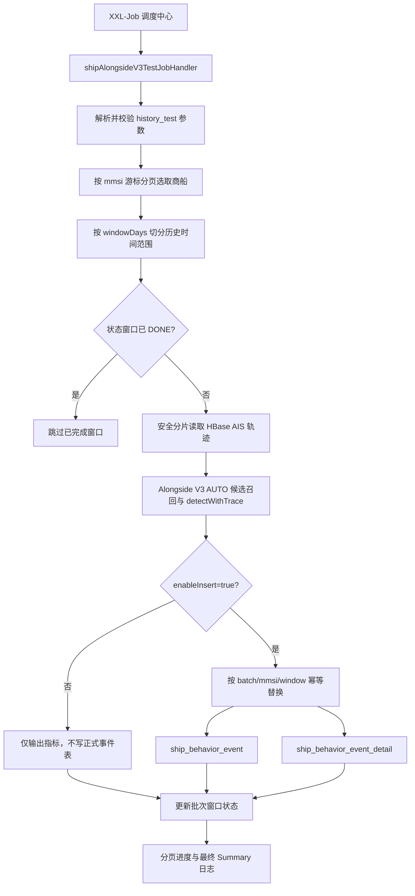

# Alongside V3 历史回放测试任务

> 归档说明：这是旧 `shipAlongsideV3TestJobHandler` 历史测试文档，不适用于
> 当前固定名单 event-only 生产任务。当前参数和状态见
> [0731液货船/集装箱船测试维护手册](../../liquid-container-behavior-test-20260731.md)。

## 1. 测试目的

该任务用于验证 Alongside V3 从历史 AIS 轨迹到行为风险数据表的完整生产链，重点是分页选船、时间切片、失败隔离、断点续跑、事件及轨迹明细入库，而不是单纯追求事件数量。

任务是独立的历史测试入口，不替代也不修改 `shipAlongsideJobHandler`、`shipAlongsideBatchJobHandler` 等现有生产入口，不引入 Kafka/Flink，不改变 `ShipAlongsideDetector` 的识别和评分规则。

## 2. 架构流程



选船使用 `mmsi > lastMmsi ORDER BY mmsi LIMIT ?`，不会把约 11 万条船一次加载到 JVM。长时间范围会继续按 `windowDays` 切片，默认每 30 天形成一个可独立重试的状态窗口。

单船单窗口异常会写入 FAILED、输出错误日志并继续处理后续窗口和船舶。任务最终只要存在失败船舶就返回 XXL-Job FAIL，便于调度中心告警；使用相同参数和 `batchNo` 重跑时会跳过 DONE，只重算 FAILED/未完成窗口。

## 3. 参数说明

任务参数必须是 JSON 对象。

| 参数 | 默认值 | 说明 |
| --- | --- | --- |
| `mode` | `history_test` | 只接受 `history_test`，防止误用为生产入口 |
| `shipLimit` | `1000` | 本次最多选择的船舶数，范围 1～`alongside.test.max-ship-limit` |
| `batchSize` | `100` | 每次选船分页大小，范围 1～`alongside.test.max-batch-size` |
| `days` | `30` | 未传明确时间时，取最近 N 天，范围 1～366 |
| `startTime` | 无 | 与 `endTime` 成对提供，格式 `yyyy-MM-dd HH:mm:ss` |
| `endTime` | 无 | 与 `startTime` 成对提供；明确时间优先于 `days` |
| `windowDays` | `30` | 检测及重试时间切片，范围 1～31；年度回放仍按月级窗口执行 |
| `enableInsert` | `false` | 只有显式为 `true` 才写事件和明细正式表 |
| `resume` | `true` | 相同批次重跑时跳过 DONE 窗口 |
| `batchNo` | 自动生成 | 事件批次号，最长 64 字符；重试必须沿用原值 |

支持的时间模式示例：

```json
{"shipLimit":1000,"batchSize":100,"days":7}
```

```json
{"shipLimit":1000,"batchSize":100,"days":30}
```

```json
{
  "mode":"history_test",
  "shipLimit":1000,
  "batchSize":100,
  "startTime":"2025-01-01 00:00:00",
  "endTime":"2025-01-31 23:59:59",
  "windowDays":30,
  "enableInsert":true,
  "batchNo":"alongside-v3-test-202501"
}
```

```json
{
  "mode":"history_test",
  "shipLimit":1000,
  "batchSize":100,
  "startTime":"2025-01-01 00:00:00",
  "endTime":"2026-01-01 00:00:00",
  "windowDays":30,
  "enableInsert":false,
  "batchNo":"alongside-v3-year-dry-run"
}
```

应用配置默认值：

```properties
alongside.test.ship-limit=1000
alongside.test.batch-size=100
alongside.test.days=30
alongside.test.window-days=30
alongside.test.max-ship-limit=110000
alongside.test.max-batch-size=1000
alongside.test.max-window-days=31
```

dry-run 和正式写入使用隔离的状态批次号：状态表中分别增加 `dry-`、`write-` 前缀，事件表仍保存原始 `batchNo`。因此同一业务批次可以先 dry-run，再开启写入，不会把 dry-run 的 DONE 误当作已入库。

正式写入采用窗口级替换：先删除相同 `batch_no + mmsi + 时间窗口` 的旧 detail/event，再写入本次结果。即使状态更新失败后再次重试，也不会不断追加重复事件。

## 4. 调度中心配置

在 XXL-Job 调度中心新增任务：

| 配置项 | 值 |
| --- | --- |
| 执行器 | 船舶事件分析 |
| JobHandler | `shipAlongsideV3TestJobHandler` |
| Cron | `0 0 3 * * ?` |
| 路由策略 | 单机或第一个 |
| 阻塞处理策略 | 单机串行 |
| 失败重试次数 | 建议 1～2 次 |

安全链路验证参数：

```json
{"shipLimit":1000,"batchSize":100,"days":30}
```

该参数默认 dry-run，不会写正式事件表。确认日志、耗时和候选质量后，使用明确批次开启写入：

```json
{
  "shipLimit":1000,
  "batchSize":100,
  "days":30,
  "enableInsert":true,
  "batchNo":"alongside-v3-test-1000-write"
}
```

若任务失败，保留相同的 `batchNo`、时间范围、`enableInsert` 和 `windowDays` 重新触发。不要在重试时改变时间边界，否则会形成新的状态窗口。

任务会输出分页日志和最终汇总，例如：

```text
Alongside V3 History Test Summary batchNo=alongside-v3-test-1000-write
statusBatchNo=write-alongside-v3-test-1000-write
shipsTotal=1000 shipsSuccess=980 shipsFailed=20 shipsSkipped=0
windowsTotal=1000 windowsSuccess=980 windowsFailed=20 windowsSkipped=0
trajectoryPoints=... candidatePairs=... confirmedEvents=... highRiskEvents=...
durationSeconds=...
```

## 5. 数据库验证 SQL

用户侧的 `score`、`risk_level` 分别对应当前表结构的 `event_score`、`severity_level`，创建时间字段为 `created_at`。

```sql
SELECT
    id,
    behavior_type,
    mmsi,
    target_mmsi,
    start_time,
    end_time,
    event_score AS score,
    severity_level AS risk_level,
    rule_version,
    batch_no,
    created_at
FROM dataanalysis.ship_behavior_event
WHERE behavior_type = 'ALONGSIDE'
  AND batch_no = 'alongside-v3-test-1000-write'
ORDER BY created_at DESC;
```

验证事件必填字段：

```sql
SELECT COUNT(*) AS invalid_event_count
FROM dataanalysis.ship_behavior_event
WHERE behavior_type = 'ALONGSIDE'
  AND batch_no = 'alongside-v3-test-1000-write'
  AND (
      mmsi IS NULL
      OR target_mmsi IS NULL
      OR start_time IS NULL
      OR end_time IS NULL
      OR event_score IS NULL
      OR severity_level IS NULL
  );
```

验证事件与 detail 数量：

```sql
SELECT
    e.mmsi,
    e.target_mmsi,
    e.start_time,
    e.end_time,
    COUNT(d.id) AS detail_points
FROM dataanalysis.ship_behavior_event e
LEFT JOIN dataanalysis.ship_behavior_event_detail d
  ON d.behavior_type = e.behavior_type
 AND d.batch_no = e.batch_no
 AND d.mmsi = e.mmsi
 AND d.target_mmsi = e.target_mmsi
 AND d.event_start_time = e.start_time
 AND d.event_end_time = e.end_time
WHERE e.behavior_type = 'ALONGSIDE'
  AND e.batch_no = 'alongside-v3-test-1000-write'
GROUP BY e.id, e.mmsi, e.target_mmsi, e.start_time, e.end_time
ORDER BY e.start_time DESC;
```

验证状态和失败原因：

```sql
SELECT
    status,
    COUNT(*) AS window_count,
    SUM(point_count) AS trajectory_points,
    SUM(candidate_target_count) AS candidate_pairs,
    SUM(event_count) AS confirmed_events
FROM dataanalysis.ship_behavior_alongside_batch_status
WHERE batch_no = 'write-alongside-v3-test-1000-write'
GROUP BY status;

SELECT mmsi, window_start_time, window_end_time, error_message
FROM dataanalysis.ship_behavior_alongside_batch_status
WHERE batch_no = 'write-alongside-v3-test-1000-write'
  AND status = 'FAILED'
ORDER BY updated_at DESC;
```

示例事件行（字段格式示意，不是生产数据库实测结果）：

| behavior_type | mmsi | target_mmsi | start_time | end_time | score | risk_level | rule_version |
| --- | --- | --- | --- | --- | ---: | --- | --- |
| ALONGSIDE | 413000001 | 413000099 | 2025-01-12 03:10:00 | 2025-01-12 04:05:00 | 62.0 | L2 | ALONGSIDE_V3_INSURANCE |

## 6. 性能测试结果

当前开发环境完成的是无外部 HBase/MySQL 的链路模拟测试，用于验证控制流，不代表生产吞吐：

| 场景 | 结果 |
| --- | --- |
| 参数解析、分页 SQL、写入门禁 | 通过 |
| 从 JobHandler 入口模拟分页、失败隔离、断点跳过 | 通过 |
| 3 船模拟链路 | 2 成功、1 失败后继续；约 0.004 秒（不含真实 I/O） |
| `mvn clean package` | 103 tests，0 failures，0 errors，0 skipped；可执行 JAR 打包通过 |

其中 Alongside V3 历史任务新增 10 个验收测试；全仓测试数还包含同一工作区中的其他模块测试。

真实 1000 船测试必须从最终 Summary 记录总耗时、轨迹点、候选对、回放失败、事件数及高风险事件数；同时监控 HBase 查询耗时、空间回放接口 P95、JVM 堆、数据库批写耗时。未连接真实历史库前，不提供虚假的“每秒船数”结论。

## 7. 11 万船扩容与实时计算后续方案

分阶段推进：

1. 1000 船 × 最近 30 天：`batchSize=100`、`windowDays=30`，先 dry-run，再用新批次写入；抽样核验事件与 detail。
2. 1 万船 × 最近 30 天：保持检测规则不变，评估 HBase/空间回放 P95、失败率、候选召回率、事件分布和数据库增长量。
3. 11 万船 × 指定年度：按 30 天窗口回放，固定 `batchNo`，依靠窗口状态断点续跑；避免一次构造 11 万船任务列表或一次加载全年轨迹。

全量阶段建议按调度分片扩展选船游标范围，并对空间回放接口设置独立并发和限流；在 1 万船基准完成前不要直接提高单实例并发。全量验收应同时输出年度行为维度指标，并与事故案例做时间对齐、分层抽样和风险因子稳定性分析。

未来实时链路保持统一 Detector：

```text
历史批处理 ─┐
            ├─ 统一 ShipAlongsideDetector ─ 行为事件标准模型 ─ 风险评分
实时 Flink ─┘
```

Flink/Kafka 只负责实时轨迹窗口、状态和候选流，不复制 Alongside V3 规则；本历史任务产出的批次数据可作为实时结果回归基线。
