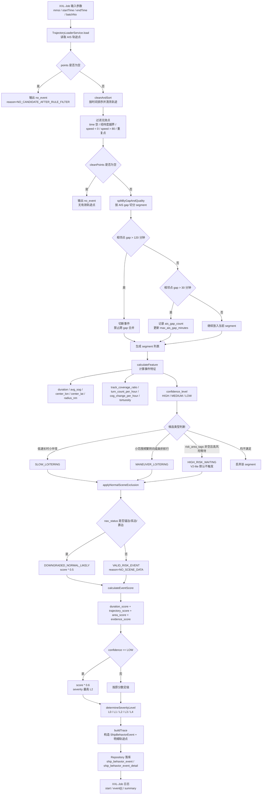

# 船舶徘徊模块开发文档

## 1. 模块目标

船舶徘徊模块用于识别单船在一定时间窗内低速、小范围、持续停留或局部机动的候选行为事件。

当前版本为 `LOITERING_V2_INSURANCE` 的 V2-lite 商业保险可用版本。它不是最终保险评分口径，也不依赖港口、锚地、天气、制裁区、STS 热点等外部数据联动。本轮重点是把以下能力接入现有稳定链路：

- 轨迹清洗
- AIS gap 切分
- 轨迹覆盖率计算
- 徘徊子类型识别
- 事件置信度
- 单事件风险评分
- L0-L4 风险等级
- V2 字段落库
- 事件明细追溯
- 启动时自动建表与自动补列
- XXL-Job 日志验收链路

## 2. 任务入口与参数

XXL-Job Handler：

- `shipLoiteringJobHandler`

代码位置：

- [ShipBehaviorJob.java](/Users/raymondlu/LocalProject/船舶风险评估数据服务/ship-risk-data/src/main/java/com/hifleet/xxljob/ShipBehaviorJob.java:19)

推荐 JSON 参数：

```json
{
  "mmsi": "413193000",
  "startTime": "2026-06-25 04:00:00",
  "endTime": "2026-06-30 10:30:00",
  "batchNo": "loitering-test-20260630-01"
}
```

字段说明：

- `mmsi`：待分析船舶
- `startTime`：分析开始时间
- `endTime`：分析结束时间
- `batchNo`：本次任务批次号，查日志、查表、清理测试数据都依赖它

也支持 key-value 形式：

```text
mmsi=413193000;startTime=2026-06-25 04:00:00;endTime=2026-06-30 10:30:00;batchNo=loitering-test-20260630-01
```

## 3. 当前代码链路

主链路如下：

```text
shipLoiteringJobHandler
-> ShipBehaviorAnalysisService.analysisLoitering
-> TrajectoryLoaderService.load
-> ShipLoiteringDetector.detectWithTrace
-> ShipBehaviorEventRepository.saveEvents
-> ShipBehaviorEventDetailRepository.saveDetails
```

关键类：

- [ShipBehaviorAnalysisService.java](/Users/raymondlu/LocalProject/船舶风险评估数据服务/ship-risk-data/src/main/java/com/hifleet/job/services/ShipBehaviorAnalysisService.java:148)
- [TrajectoryLoaderService.java](/Users/raymondlu/LocalProject/船舶风险评估数据服务/ship-risk-data/src/main/java/com/hifleet/trajectory/TrajectoryLoaderService.java:1)
- [ShipLoiteringDetector.java](/Users/raymondlu/LocalProject/船舶风险评估数据服务/ship-risk-data/src/main/java/com/hifleet/service/ShipLoiteringDetector.java:20)
- [ShipBehaviorEventRepository.java](/Users/raymondlu/LocalProject/船舶风险评估数据服务/ship-risk-data/src/main/java/com/hifleet/repository/ShipBehaviorEventRepository.java:25)
- [ShipBehaviorTableInitializer.java](/Users/raymondlu/LocalProject/船舶风险评估数据服务/ship-risk-data/src/main/java/com/hifleet/repository/ShipBehaviorTableInitializer.java:47)

职责边界：

- job handler 只负责接参数、返回执行结果
- service 负责轨迹读取、日志、落库、批次追踪
- detector 负责识别徘徊片段，不直接写库
- repository 负责写 `dataanalysis`
- table initializer 负责启动时建表和补列

## 4. V2-lite 规则说明

规则版本：

- `ship.behavior.loitering.rule-version=LOITERING_V2_INSURANCE`

### 4.0 指标计算流程图

船舶徘徊 V2-lite 的计算过程不是单一阈值判断，而是先保证轨迹质量，再做事件切分和候选识别，最后结合置信度、正常场景降权和风险评分形成可落库事件。



关键中间指标说明：

- `duration_minutes`：segment 首尾点时间差，单位分钟
- `avg_sog`：segment 内轨迹点平均航速
- `center_lon / center_lat`：segment 内经纬度算术平均中心点
- `radius_nm`：中心点到 segment 内所有点的最大距离，单位海里
- `ais_gap_count`：segment 内相邻点时间间隔超过 `max-gap-minutes` 的次数
- `max_ais_gap_minutes`：segment 内最大相邻点时间间隔
- `track_coverage_ratio`：轨迹覆盖率，用于识别“持续时间很长但点数很少”的低可信事件
- `turn_count_per_hour`：每小时显著转向次数，显著转向阈值默认 `45` 度
- `cog_change_per_hour`：每小时累计航向变化，COG 使用环形差值，`350 -> 10` 按 `20` 度计算
- `tortuosity`：轨迹曲折系数，优先用 `actual_distance_nm / direct_distance_nm`
- `confidence_level`：轨迹证据可信度，影响最终评分和最高等级

计算链路输出的核心字段：

- `event_sub_type`：`SLOW_LOITERING`、`MANEUVER_LOITERING`、`HIGH_RISK_WAITING`
- `severity_level`：`L0-L4`
- `event_score`：单事件风险分，范围 `0-100`
- `confidence_level`：`HIGH`、`MEDIUM`、`LOW`
- `exclusion_flag`：`EXCLUDED_NORMAL`、`DOWNGRADED_NORMAL_LIKELY`、`VALID_RISK_EVENT`
- `score_detail_json`：记录 `durationScore`、`trajectoryScore`、`areaScore`、`evidenceScore`、置信度调整和正常场景调整

### 4.1 轨迹清洗

`cleanAndSort` 会执行：

- 按 `point_time` 升序
- 过滤时间为空
- 过滤经纬度越界
- 过滤 `speed < 0`
- 过滤 `speed > max-valid-speed`，默认 `80.0`
- 同一 `time + lon + lat` 去重
- `course` 越界不删点，但转向计算跳过该点

### 4.2 AIS gap 切分

默认配置：

```properties
ship.behavior.loitering.max-gap-minutes=30
ship.behavior.loitering.event-split-gap-minutes=120
```

判定逻辑：

- `gapMinutes > 30`：记录 `ais_gap_count`，更新 `max_ais_gap_minutes`，事件置信度下降
- `gapMinutes > 120`：必须切断 segment，不允许跨越该 gap 合并事件
- 持续时间很长但点数较少时，会通过 `track_coverage_ratio` 和点数规则降为 `LOW`

### 4.3 轨迹覆盖率与置信度

覆盖率公式：

```text
expectedPointCount = floor(duration_minutes / maxGapMinutes) + 1
track_coverage_ratio = min(1.0, point_count / expectedPointCount)
```

置信度：

- `HIGH`：`coverage >= 0.8`，`maxGap <= 30`，`pointCount >= 12`
- `MEDIUM`：`coverage >= 0.6`，`maxGap <= 120`
- `LOW`：`coverage < 0.6`，或 `pointCount < 12`，或 `maxGap > 120`

`LOW` 事件可以落库，但 `event_score` 乘以 `0.6`，且最高不超过 `L2`。

### 4.4 徘徊子类型

`SLOW_LOITERING` 默认阈值：

```text
avg_sog <= 2.0
duration_minutes >= 240
radius_nm <= 3.0
point_count >= 12
```

`MANEUVER_LOITERING` 默认阈值：

```text
0.5 <= avg_sog <= 5.0
duration_minutes >= 120
radius_nm <= 5.0
```

并满足任一：

```text
turn_count_per_hour >= 3
OR cog_change_per_hour >= 120
OR tortuosity >= 3.0
```

`HIGH_RISK_WAITING`：

- V2-lite 只保留接口
- `ship.behavior.loitering.high-risk.enabled=false`
- `risk_area_tags` 默认空
- 不虚构制裁区、海盗区、STS 热点数据

### 4.5 正常场景降权

V2-lite 不强依赖港口、锚地、天气、作业区 polygon。

当前降级版规则：

- 如果 `nav_status` 明确命中锚泊、系泊、靠泊：`exclusion_flag=DOWNGRADED_NORMAL_LIKELY`，`exclusion_reason=NAV_STATUS_ANCHORED_OR_MOORED`
- 如果没有任何场景数据：`exclusion_flag=VALID_RISK_EVENT`，`exclusion_reason=NO_SCENE_DATA`

注意：`DOWNGRADED_NORMAL_LIKELY` 不是完全排除事件，而是降权参与评分。

### 4.6 单事件评分

```text
event_score = duration_score + trajectory_score + area_score + evidence_score
```

评分项：

- `duration_score`：0-25
- `trajectory_score`：0-25
- `area_score`：V2-lite 默认 0
- `evidence_score`：AIS gap 相关证据，封顶 25

调整：

- `DOWNGRADED_NORMAL_LIKELY`：乘以 `0.5`
- `LOW_CONFIDENCE`：乘以 `0.6`
- `EXCLUDED_NORMAL`：置为 `0`

等级：

- `0`：`L0`
- `1-25`：`L1`
- `26-50`：`L2`
- `51-75`：`L3`
- `76-100`：`L4`

## 5. 配置项

源码默认配置位于：

- [application.properties](/Users/raymondlu/LocalProject/船舶风险评估数据服务/ship-risk-data/src/main/resources/application.properties:129)

线上以服务器 `/data/zhengyi/application.properties` 为准，源码配置只作为默认值。

核心 V2-lite 配置：

```properties
ship.behavior.loitering.rule-version=LOITERING_V2_INSURANCE
ship.behavior.loitering.max-gap-minutes=30
ship.behavior.loitering.event-split-gap-minutes=120
ship.behavior.loitering.min-track-coverage-ratio=0.6
ship.behavior.loitering.min-score-points=12
ship.behavior.loitering.min-warning-points=6
ship.behavior.loitering.max-valid-speed=80.0
ship.behavior.loitering.slow.max-speed=2.0
ship.behavior.loitering.slow.min-duration-minutes=240
ship.behavior.loitering.slow.max-radius-nm=3.0
ship.behavior.loitering.slow.min-points=12
ship.behavior.loitering.maneuver.min-speed=0.5
ship.behavior.loitering.maneuver.max-speed=5.0
ship.behavior.loitering.maneuver.min-duration-minutes=120
ship.behavior.loitering.maneuver.max-radius-nm=5.0
ship.behavior.loitering.maneuver.min-turn-count-per-hour=3
ship.behavior.loitering.maneuver.min-cog-change-per-hour=120
ship.behavior.loitering.maneuver.min-tortuosity=3.0
ship.behavior.loitering.maneuver.turn-threshold-degree=45
ship.behavior.loitering.high-risk.enabled=false
ship.behavior.loitering.high-risk.min-duration-minutes=60
ship.behavior.loitering.high-risk.max-radius-nm=5.0
ship.behavior.loitering.score.weight=0.20
```

## 6. 数据落库与自动建表补列

事件摘要表：

- `dataanalysis.ship_behavior_event`
- DDL：[ship_behavior_event.sql](/Users/raymondlu/LocalProject/船舶风险评估数据服务/ship-risk-data/src/main/resources/sql/ship_behavior_event.sql:1)

事件明细表：

- `dataanalysis.ship_behavior_event_detail`
- DDL：[ship_behavior_event_detail.sql](/Users/raymondlu/LocalProject/船舶风险评估数据服务/ship-risk-data/src/main/resources/sql/ship_behavior_event_detail.sql:1)

V2-lite 新增摘要字段：

- `event_sub_type`
- `severity_level`
- `event_score`
- `confidence_level`
- `exclusion_flag`
- `exclusion_reason`
- `ais_gap_count`
- `max_ais_gap_minutes`
- `track_coverage_ratio`
- `turn_count_per_hour`
- `cog_change_per_hour`
- `tortuosity`
- `center_lon`
- `center_lat`
- `radius_nm`
- `score_detail_json`

启动时自动处理：

- 如果 `ship_behavior_event` 不存在，自动执行完整 DDL 建表
- 如果 `ship_behavior_event` 已存在，逐列检查 V2-lite 必需字段
- 缺失字段会逐列执行 `ALTER TABLE ... ADD COLUMN`
- 任一必需列补齐失败，应用启动失败，避免后续写库时报隐蔽错误
- `ship_behavior_event_detail` 本轮只保持自动建表，不做补列

启动日志关键字：

```text
ship_behavior_event exists, skip ddl
ship_behavior_event column missing, applying migration: event_sub_type
ship_behavior_event column ready: event_sub_type
ship_behavior_event schema ready
```

人工排查 SQL 文件：

- [ship_behavior_event_v2_loitering_alter.sql](/Users/raymondlu/LocalProject/船舶风险评估数据服务/ship-risk-data/src/main/resources/sql/ship_behavior_event_v2_loitering_alter.sql:1)

注意：程序不会整包执行这个 ALTER 文件，因为部分字段已存在时整包 ALTER 会失败。程序实际使用 `ShipBehaviorTableInitializer` 内置的逐列 migration。

## 7. 日志格式与验收点

任务开始：

```text
LOITERING_V2 start mmsi=413193000 startTime=2026-06-25 04:00:00 endTime=2026-06-30 10:30:00 batchNo=loitering-test-20260630-01 ruleVersion=LOITERING_V2_INSURANCE
```

事件摘要：

```text
event[1] type=LOITERING subType=SLOW_LOITERING severity=L1 confidence=MEDIUM start=2026-06-29 19:46:08 end=2026-06-30 04:39:15 duration=533 radiusNm=0.17389501702977303 avgSpeed=0.2076923076923077 pointCount=13 maxGap=114 coverage=0.7222222222222222 score=24.0 exclusion=DOWNGRADED_NORMAL_LIKELY reason=NAV_STATUS_ANCHORED_OR_MOORED batchNo=loitering-test-20260630-01
```

任务汇总：

```text
LOITERING_V2 summary mmsi=413193000 points=115 cleanPoints=115 segments=23 candidates=1 events=1 excludedEvents=1 lowConfidenceEvents=0 batchNo=loitering-test-20260630-01
```

兼容旧摘要：

```text
徘徊 mmsi=413193000 points=115 events=1
```

当前日志中的 `excludedEvents` 包含 `DOWNGRADED_NORMAL_LIKELY`，它表示“正常可能性较高并降权”，不是完全排除。后续可考虑拆成 `excludedEvents` 和 `downgradedEvents` 两个字段。

## 8. 部署后单船测试记录

测试时间：

- `2026-06-30 15:18:18`

任务参数：

```json
{"mmsi":"413193000","startTime":"2026-06-25 04:00:00","endTime":"2026-06-30 10:30:00","batchNo":"loitering-test-20260630-01"}
```

XXL-Job 返回：

```text
ReturnT [code=200, msg=processed=1, failed=0, events=1, content=null]
```

验证结论：

- 服务启动正常，Tomcat 运行在 `8090`
- XXL-Job executor remoting server 启动正常，端口 `30008`
- `shipLoiteringJobHandler` 注册并执行成功
- HBase/ZooKeeper 连接正常
- 轨迹读取成功：`points=115`
- 轨迹清洗正常：`cleanPoints=115`
- AIS gap 切分生效：`segments=23`
- 候选事件：`candidates=1`
- 命中事件：`events=1`
- 未出现 Java 异常堆栈

本次命中事件解释：

- 子类型：`SLOW_LOITERING`
- 持续时间：`533` 分钟
- 活动半径：`0.173895` 海里
- 平均航速：`0.2077` 节
- 点数：`13`
- 最大 AIS gap：`114` 分钟
- 覆盖率：`0.7222`
- 置信度：`MEDIUM`
- 正常场景降权：`DOWNGRADED_NORMAL_LIKELY`
- 原因：`NAV_STATUS_ANCHORED_OR_MOORED`
- 评分：`24.0`
- 等级：`L1`

规则解释：

- 满足 `SLOW_LOITERING` 的速度、时长、半径和点数要求
- `maxGap=114` 未超过事件切分阈值 `120`，但超过高置信要求 `30`
- `coverage=0.7222` 满足 `MEDIUM`，不满足 `HIGH`
- 因 `nav_status` 命中锚泊/系泊类状态，事件降权到 `L1`
- V2 没有把 115 个多天点合并成超长高置信事件，gap 切分按预期工作

## 9. SQL 验证脚本

查看表和字段：

```sql
SHOW TABLES LIKE 'ship_behavior%';

SHOW COLUMNS FROM dataanalysis.ship_behavior_event;
```

查询事件摘要：

```sql
SELECT
  id,
  behavior_type,
  mmsi,
  start_time,
  end_time,
  duration_minutes,
  event_sub_type,
  severity_level,
  event_score,
  confidence_level,
  exclusion_flag,
  exclusion_reason,
  ais_gap_count,
  max_ais_gap_minutes,
  track_coverage_ratio,
  turn_count_per_hour,
  cog_change_per_hour,
  tortuosity,
  radius_nm,
  score_detail_json,
  batch_no
FROM dataanalysis.ship_behavior_event
WHERE batch_no = 'loitering-test-20260630-01'
  AND mmsi = '413193000'
  AND behavior_type = 'LOITERING'
ORDER BY start_time;
```

查询事件明细：

```sql
SELECT *
FROM dataanalysis.ship_behavior_event_detail
WHERE batch_no = 'loitering-test-20260630-01'
  AND mmsi = '413193000'
ORDER BY event_start_time, point_index;
```

清理测试批次：

```sql
DELETE FROM dataanalysis.ship_behavior_event_detail
WHERE batch_no = 'loitering-test-20260630-01';

DELETE FROM dataanalysis.ship_behavior_event
WHERE batch_no = 'loitering-test-20260630-01';
```

## 10. 服务器日志排查

查看启动建表和补列：

```bash
grep -n "ship_behavior_event" /data/zhengyi/logs/log.log | tail -100
grep -n "schema ready\\|column missing\\|column ready\\|skip ddl\\|created" /data/zhengyi/logs/log.log | tail -100
```

查看徘徊任务：

```bash
grep -n "LOITERING_V2\\|徘徊 mmsi=413193000\\|event\\[1\\]" /data/zhengyi/logs/log.log | tail -100
```

常见问题：

- 没有启动补列日志：确认日志截取时间是否覆盖应用启动阶段
- 启动失败且出现 `ensure column failed`：检查数据库账号是否有 `ALTER TABLE` 权限，或字段是否存在类型冲突
- `points=0`：检查 `mmsi`、时间窗、HBase 轨迹源配置
- `segments` 很多：说明 AIS gap 切分生效，继续看 `maxGap` 和明细点时间
- `events=0`：看是否低速、时长、半径、点数、机动指标不足
- 事件看起来不合理：查询明细表，按 `point_time` 检查速度、经纬度、航向、导航状态

## 11. 本地验证记录

本地编译：

```text
mvn -DskipTests compile
BUILD SUCCESS
```

本地单测：

```text
JUnitCore ShipLoiteringDetectorTest ShipBehaviorTableInitializerTest
OK (15 tests)
```

覆盖内容：

- 空轨迹返回空事件
- 点数不足返回空事件
- `gap > 120` 切断事件
- 低速 4 小时小半径生成 `SLOW_LOITERING`
- 频繁转向生成 `MANEUVER_LOITERING`
- COG `350 -> 10` 差值按 `20` 计算
- 低覆盖率标记 `LOW_CONFIDENCE`
- `LOW_CONFIDENCE` 最高不超过 `L2`
- 锚泊/系泊状态触发降权
- `score_detail_json` 非空
- 表不存在时自动建表
- 字段齐全时不执行 ALTER
- 缺单列时只补单列
- 缺多列时按顺序补列
- 补列失败时启动初始化失败

## 12. 后续建议

- 将 summary 中的 `excludedEvents` 拆分为 `excludedEvents` 和 `downgradedEvents`
- 后续接入锚地、港口、天气、制裁区、STS 热点等外部场景数据后，再启用更完整的正常场景排除和 `HIGH_RISK_WAITING`
- 年度 WLI 汇总表本轮未落库，可在事件规则稳定后单独实现
- 明细表仍只作为事件轨迹快照，不作为长期 AIS 原始轨迹归档表
