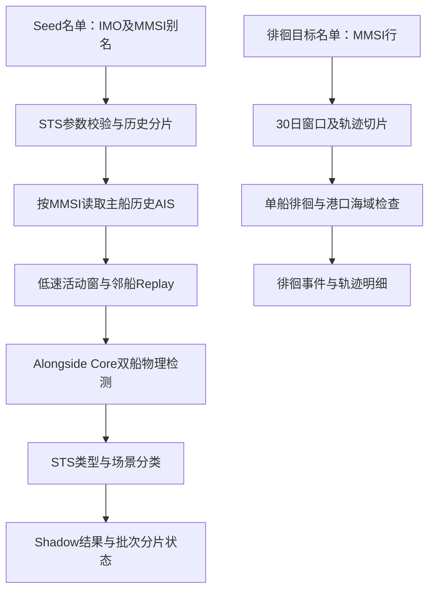

# STS 阅读与学习指南

本文面向第一次接触本项目的同学，说明当前交付结果的来源和对应代码。先理解“观测到了什么”，再阅读检测和分类，最后看调度、数据库及运行参数。

## 版本与任务背景

当前学习快照采用原始源码 `d48eec580960a96b258ce05146afc64946c75bc9`，对应 2026-11-12 核验的服务器在用旧5K运行包。旧5K是包的历史称呼，当前任务已使用新的商船名单，不是只算5,000艘。具体 JAR 摘要和验证记录见 [PUBLISHED_VERSION.md](PUBLISHED_VERSION.md)。

业务规则以人工批准的 [STS_DEVELOPMENT.md](STS_DEVELOPMENT.md) 为准。本文整理既有规则与运行事实，不新增阈值或转运认定标准。旧 Phase 文档中的船数、批次和执行步骤属于当时范围。

| 项目 | 本次任务口径 |
| --- | --- |
| 计划窗口 | Asia/Shanghai，`[2026-08-05 00:00:00, 2026-11-05 00:00:00)`，92天 |
| 名单批次 | `sts-merchant-cargo-20261110-v1` |
| 名单规模 | 21,881个 IMO / 43,200个 MMSI 别名 |
| 类型范围 | 集装箱、油类/化学品/通用液货、LNG/LPG/通用气体船；不覆盖所有商船类型 |
| 名单筛选 | 有效标识、完整船名/船型及同一资料行的正整数长宽，保留无已知冲突的完整别名 |
| 身份限制 | 国际资格与事件时刻历史身份均为 `NOT_VERIFIED`；没有挂港、70米、固定5,000艘等筛选门槛 |
| STS 批次 | `sts-merchant-cargo-20261110-v1-prod-20260805-1105-r2` |
| 徘徊批次 | `loitering-merchant-cargo-20261110-v1-prod-20260805-1105` |

IMO 是名单中的船舶归属，MMSI 是读取 AIS 轨迹的标识。同一 IMO 的多个 MMSI 不应作为多艘船相加。当前名单没有验证这些别名在整个历史窗口内的有效身份区间。

## 事件分类与字段

搭靠物理检测回答“两船是否有持续近距离、速度及航向关系证据”。STS 分类在这些物理证据上结合对船类型和场景，给出复核线索；没有验证货物是否实际转移。

| 字段值 | 含义及阅读方法 |
| --- | --- |
| `OBSERVED_ALONGSIDE` | 保存的搭靠观测记录，不表示已确认转运 |
| `physicalSupportLevel=FORMAL` | 物理支持满足正式候选条件；仍需看 STS 分类 |
| `physicalSupportLevel=WEAK` | 弱物理证据，保留记录但不提升至 STS 候选/待核队列 |
| `STS_CANDIDATE` | 正式物理证据且对船类型支持 tanker-like 的疑似线索 |
| `STS_REVIEW_REQUIRED` | 正式物理证据存在，但类型未知、冲突或不足以支持上述候选判断，需要复核 |
| `PHYSICAL_ONLY` | 仅保留物理证据，例如弱支持、明确服务船替代解释、已知港口/泊位静态并靠 |
| `UNDERWAY_PARALLEL_COMPANIONSHIP` | 航行伴航模式，不能仅凭模式名称认定为转运 |
| `STATIONARY_SIDE_BY_SIDE_REVIEW` | 静态并靠待核模式，也需排查港口、锚地和正常作业解释 |
| `sceneType=UNKNOWN` | 场景数据不足；不能解释为已确认港外或海上 |
| `riskScoreStatus=DISABLED` | 当前 STS 评分未启用；不要把 Core 诊断分数当作正式 STS 风险评分 |

分类顺序见 [StsHistoricalClassification.java](../../src/main/java/com/hifleet/sts/service/StsHistoricalClassification.java)：先判弱支持，再判明确服务船、已知港口静态替代，之后判断 tanker-like，其余保留待核。`FORMAL`、`CONFIRMED` 等 Core 字样属于物理检测语义，不是对实际转运的确认。

徘徊是单船线索。`MANEUVER_LOITERING`、`SLOW_LOITERING`、`COMPOSITE_LOITERING` 分别表示机动、低速和复合徘徊。`L1/L2/L3`、`event_score` 是算法输出；还须同时查看 `exclusion_flag`。`DOWNGRADED_NORMAL_LIKELY` 是更可能正常的降级记录，不应与 `VALID_RISK_EVENT` 混为全部异常事件。最低航速1kn拆分轨迹，不能声称覆盖所有异常停船。

| 结果字段 | 单位 / 解释 |
| --- | --- |
| `id`、`event_key`、`batch_no` | 追溯记录与批次；记录行数不自动等于独立发生次数 |
| `own_imo/own_mmsi`、`target_imo/target_mmsi` | 主船与对船标识，保留事件原值；补充资料不能覆盖原始身份 |
| `start_time/end_time` | 北京时间；事件持续时间与AIS证据点数应一起判断 |
| `min_distance_nm/avg_distance_nm` | 最小/平均两船距离，海里；1nm=1.852km |
| `own_avg_speed_kn/target_avg_speed_kn` | 主船/对船平均航速，节 |
| `matchedPointCount`、`headingParallelRatio` | 配对证据点数及平行比例，见 `score_detail_json` |
| `classificationReason`、`contextEvidence` | 分类原因和服务船、港口、锚地等上下文 |
| `score_detail_json` | 规则版本、场景、来源、点数和轨迹回看配方等证据；不是只看单个评分 |

同一船对可能有方向相反或时间重叠的记录；按批次、规范船对和时间核查后再做独立事件统计。两类事件不能简单相加作为 STS 总数。徘徊按事件开始时间归入窗口，边界上下文可能使结束时间越过批次结束，应保留原值并说明。

## 计算流程与源码导航



按以下顺序读代码即可，不必先通读所有历史 Handler。

| 顺序 | 代码入口 | 重点问题 |
| --- | --- | --- |
| 1 | [StsJobs](../../src/main/java/com/hifleet/sts/xxljob/StsJobs.java) 的 `shipStsAlongsideHistoryJobHandler` | 当前 XXL 入口如何解析参数、返回状态？ |
| 2 | [StsAlongsideHistoryJobParams](../../src/main/java/com/hifleet/sts/domain/StsAlongsideHistoryJobParams.java) | `shipCount` 按什么计数？哪些参数拒绝执行？ |
| 3 | [StsAlongsideHistoryService](../../src/main/java/com/hifleet/sts/service/StsAlongsideHistoryService.java) | `runOneInvocation`、`processSlice`、`persistCandidate` 如何连接名单、计算和保存？ |
| 4 | [ShipBehaviorAnalysisService](../../src/main/java/com/hifleet/job/services/ShipBehaviorAnalysisService.java) | `computeAlongsideHistory` 如何复用现有 Core？ |
| 5 | [TrajectoryLoaderService](../../src/main/java/com/hifleet/trajectory/TrajectoryLoaderService.java) 与 [ShipAlongsideReplayCandidateProvider](../../src/main/java/com/hifleet/service/ShipAlongsideReplayCandidateProvider.java) | 主船历史轨迹和邻船 Replay 分别从哪里来？ |
| 6 | [ShipAlongsideDetector](../../src/main/java/com/hifleet/service/ShipAlongsideDetector.java) | 配对、近距/速度/航向约束、静态分支和弱证据如何工作？ |
| 7 | [StsHistoricalClassification](../../src/main/java/com/hifleet/sts/service/StsHistoricalClassification.java) | 为什么正式物理支持仍可能是 `PHYSICAL_ONLY`？ |
| 8 | [StsShadowEventRepository](../../src/main/java/com/hifleet/sts/repository/StsShadowEventRepository.java) | Shadow写入、幂等及重叠查询的范围是什么？ |
| 9 | [StsBackfillPlanner](../../src/main/java/com/hifleet/sts/service/StsBackfillPlanner.java)、[任务状态仓库](../../src/main/java/com/hifleet/sts/repository/StsBackfillTaskRepository.java) | 如何分片、恢复、记录单船失败及批次完成度？ |

徘徊入口在 [ShipBehaviorProductionJobs](../../src/main/java/com/hifleet/xxljob/ShipBehaviorProductionJobs.java) 的 `shipLoiteringProductionTestJobHandler`，依次阅读 [LoiteringProductionTestService](../../src/main/java/com/hifleet/job/services/LoiteringProductionTestService.java)、[ShipLoiteringDetector](../../src/main/java/com/hifleet/service/ShipLoiteringDetector.java)、[LoiteringPortEventGate](../../src/main/java/com/hifleet/loitering/LoiteringPortEventGate.java)、[WorldSeaEventGate](../../src/main/java/com/hifleet/worldsea/WorldSeaEventGate.java) 和 [BehaviorEventTransactionStore](../../src/main/java/com/hifleet/service/BehaviorEventTransactionStore.java)。当前批次使用V2徘徊引擎；仓库中有V3能力不等于本批使用了V3。

## 参数与完成度

| 参数 | 当前 STS 入口语义 |
| --- | --- |
| `mode` | `STS_ALONGSIDE_HISTORY_V1` |
| `seedBatchNo` | 已验证的Seed名单批次；空名单、格式/别名冲突或顺序异常会拒绝 |
| `shipOffset/shipCount` | 从0开始，按规范IMO组选择；每组保留全部合法别名；本批 `shipCount=21881` |
| `imos` | 可显式指定Seed中存在的IMO；与默认范围选择的关系以参数和选船代码为准 |
| `from/to` | 必填的固定时间范围，左闭右开；不随今天自动滚动 |
| `sliceDays` | 1–7天；当前92天按7天切为14片 |
| `regionSetCode` | 需能加载有效区域集；当前历史链路的区域归属为 `CONTEXT_ONLY`，不能套用旧区域前置筛选 Handler 的语义 |
| `writeMode/parallelism/resume` | 当前入口要求 `SHADOW_ONLY` / `1` / `true` |
| `autoContinue` | 是否在一次调用内继续后续分片，不表示无限运行 |
| `maxSlicesPerInvocation/maxRuntimeMinutes` | 默认8片/90分钟；预算在分片边界检查，不是强行中断当前分片的精确超时 |

徘徊参数由 [ProductionTestParams](../../src/main/java/com/hifleet/job/services/ProductionTestParams.java) 解析。`expectedShipCount/shipLimit` 的分母是目标表MMSI行，本批为43,200，不能填21,881。`windowDays=30`、`trajectorySliceHours=6`；92天对应30+30+30+2天四个窗口。`enableInsert=false` 仅限制事件保存，不保证整个任务无状态写入，因此学习时优先运行离线测试。

核心距离、速度和时长参数在 [application.properties](../../src/main/resources/application.properties) 的 `ship.behavior.alongside.*` / `ship.behavior.loitering.*`，由 [ShipBehaviorAnalysisService](../../src/main/java/com/hifleet/job/services/ShipBehaviorAnalysisService.java) 组装成规则。候选搜索和正式物理检测是两层约束；不要把旧兼容参数 `max-distance-nm` 当作新确认层 `confirm.max-distance-nm`。

以当前运行配置为例，搭靠候选/确认距离0.27nm、确认最大航速3kn、相对航速差不超过1kn；弱支持20分钟/3点，正式支持30分钟/6点；航向差阈值30°、平行比例0.8。确认最小航速1kn同时存在双方低于1kn的静态分支，并非简单排除全部静止片段。外置配置可覆盖仓库默认值，复现时应一起核对JAR、配置摘要、规则版本及场景数据，不能只复制这一组数字。

| 状态 / 现象 | 含义 |
| --- | --- |
| XXL ReturnT=200 | 一次调用正常返回，可能只完成部分分片；不能代替全批完成 |
| `PENDING/RUNNING` | 仍有待处理或运行中的范围 |
| `COMPLETE_WITH_WARNINGS` | 已结束但有单船失败等缺口；必须查看 `last_error` 和失败名单 |
| `FAILED/PARTIAL_FAILED` | 需保留失败范围和原因；不能以零事件代表已健康计算 |
| 恢复指纹冲突 | 名单、选择范围、区域、规则或配置等与原批不一致，应停止排查；不能直接换包复用旧批次 |

## 数据库与只读核查

实际数据库连接由外置配置的 `newdataanalysis` 数据源提供。仓库保留表结构和只读示例，不包含生产连接凭据。

| 表 | 内容 |
| --- | --- |
| `dataanalysis.ship_sts_seed_identity` | STS名单，按 `seed_batch_no` 限定 |
| `dataanalysis.ship_behavior_target_ship` | 徘徊目标名单，按 `list_batch_no` 限定 |
| `dataanalysis.ship_sts_backfill_batch/task` | STS批次和分片状态，实际为两张表 |
| `dataanalysis.ship_sts_shadow_event` | STS物理观测和候选分类；`score_detail_json` 保存证据 |
| `dataanalysis.ship_behavior_event` | 徘徊等行为事件，本批限定 `behavior_type='LOITERING'` |
| `dataanalysis.ship_behavior_event_detail` | 轨迹明细，没有直接 `event_id` 列 |
| `dataanalysis.ship_behavior_loitering_batch_status` | 徘徊MMSI窗口状态 |

只读示例，需先获得数据访问权限：

```sql
SELECT slice_seq, slice_from, slice_to, status, processed_ship_count, last_error
FROM dataanalysis.ship_sts_backfill_task
WHERE batch_no = 'sts-merchant-cargo-20261110-v1-prod-20260805-1105-r2'
ORDER BY slice_seq;

SELECT id, own_imo, own_mmsi, target_imo, target_mmsi, start_time, end_time,
       JSON_UNQUOTE(JSON_EXTRACT(score_detail_json, '$.stsClassification')) AS sts_classification
FROM dataanalysis.ship_sts_shadow_event
WHERE batch_no = 'sts-merchant-cargo-20261110-v1-prod-20260805-1105-r2'
ORDER BY id DESC
LIMIT 20;
```

徘徊事件与明细的关联键为批次、行为类型、MMSI、事件开始/结束时间和规则版本。导出新增的“事件记录ID”是关联得到的展示字段，不是明细表原生列。DDL脚本见 [sql目录](../../src/main/resources/sql)；阅读表定义不代表可直接执行建表、迁移或数据写入。

## 本地测试与配置

使用JDK8和Maven。离线单元测试构造轨迹、模拟数据源及仓库，不需要生产AIS、数据库密码或XXL账号，也不会启动Spring服务。先跑小组测试观察输入和断言：

```bash
java -version
mvn -version
mvn -Dtest=StsHistoricalClassificationTest,StsAlongsideHistoryServiceTest,StsImoSelectionTest,ShipAlongsideDetectorTest test
```

优先阅读 [分类测试](../../src/test/java/com/hifleet/sts/service/StsHistoricalClassificationTest.java)、[历史链路测试](../../src/test/java/com/hifleet/sts/service/StsAlongsideHistoryServiceTest.java)、[身份选船测试](../../src/test/java/com/hifleet/sts/StsImoSelectionTest.java) 和 [物理检测测试](../../src/test/java/com/hifleet/service/ShipAlongsideDetectorTest.java)。尝试解释测试中的WEAK、服务船、UNKNOWN场景、别名、自配对及单船失败，随后再修改合成输入学习边界。扩展验证命令和本次实际测试结果见 [仓库README](../../README.md#本地验证) 与 [版本记录](PUBLISHED_VERSION.md)。

真实运行还需要私有环境提供以下配置。将实际值放在被Git忽略的外置 `application.properties` 或环境变量中；不要提交密码、轨迹及名单导出。

| 环境变量 | 用途 |
| --- | --- |
| `DB_AIS41_*`、`DB_AIS41READONLY_*` | 业务/只读资料源 |
| `DB_DATAANALYSIS_*`、`DB_NEWDATAANALYSIS_*` | 分析与结果数据源 |
| `DB_DB3NEWAIS41_*`、`DB_DB3NEWALERTRS_*`、`DB_COMMODITY_*`、`DB_WGQ111_PG_*` | 既有服务的其他数据源；每组后缀是 `URL`、`USERNAME`、`PASSWORD` |
| `HBASE_ZK_QUORUM` | 历史AIS的HBase连接 |
| `AIS_REPLAY_URL` | 邻船轨迹Replay服务地址 |
| `XXLJOB_ACCESSTOKEN`、`SHIP_BEHAVIOR_TRACE_REPLAY_TOKEN` | XXL与轨迹回看鉴权，按环境要求提供 |

未提供必需连接配置时，服务无法完成初始化属于预期；离线单元测试和本地打包不受影响。公开配置是模板，不是服务器实际外置配置的副本。`deploy/package.sh` 只生成本地 `dist/`，不部署、不建表、不触发任务。

想继续实验时，请先使用独立测试库、合成轨迹和新批次，核对名单/区域快照；实际部署、生产DB写入、名单导入或XXL任务执行分别取得授权。旧 Handler 和旧运行手册保留作历史阅读，不按其中的历史批次直接执行。
