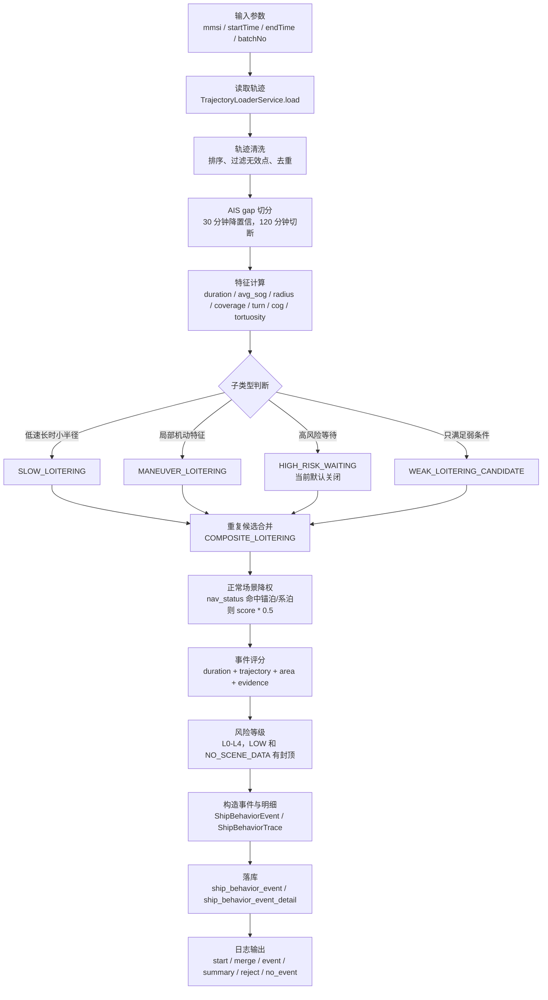

# 船舶徘徊指标 SHUJUFUWU-306 项目文档

## 1. 一句话结论

当前 `ship-risk-data` 已完成 `LOITERING_V2_INSURANCE` 的 V2-lite/V2.1 初步实现，支持 AIS 轨迹清洗、gap 切分、低速徘徊、机动徘徊、弱候选诊断、重复候选合并、事件评分、风险等级和事件明细落库。当前输出定位是保险风控候选事件识别与人工复核依据，尚不是最终保险评分口径，也不直接等同于核保结论。

## 2. 业务定位与保险风控价值

船舶徘徊在保险风控里有价值，是因为它可能对应以下风险线索：

- 长时间低速、小半径停留，可能对应异常等待、规避正常航线、局部作业或高风险接触前后行为。
- 小范围机动、频繁转向、曲折航迹，可能反映靠近某目标、等待会合、规避监测或反复定位调整。
- AIS gap 与徘徊同时出现时，可能提示证据链不完整，需要重点复核。

但徘徊不是天然异常，必须结合场景判断：

- 船舶在锚地、港外待泊区、港口附近、系泊区、正常装卸等待区，本来就可能出现低速、小范围、长时间停留。
- 渔业支持、补给等待、气象避让、交通组织等待等，也可能形成“像徘徊”的轨迹。
- 因此当前指标只回答“是否存在值得复核的候选事件”，不回答“是否已经确认异常”。

它与其他风险数据之间是互补关系：

- 与异常停泊：徘徊更强调轨迹形态和持续行为，异常停泊更偏结果状态。
- 与 AIS 中断：AIS 中断可作为证据强化项，但不能单独证明异常。
- 与搭靠、STS：徘徊常是搭靠、STS 或等待会合的前置或伴随行为。
- 与制裁区、海盗区、战区：这些是高风险场景数据，能决定“同样的徘徊是否更值得警惕”。
- 与港口、锚地、泊位：这些是正常场景排除的关键数据，能减少误报。

当前指标适合用于以下业务场景：

- 核保辅助：给核保人员提供行为候选和复核入口，不直接给出拒保结论。
- 理赔调查：回溯事故前是否存在异常等待、低速盘旋、局部机动。
- 船队风险画像：作为船东、船队一年行为模式的候选样本来源。
- 行为风险样本库：为后续规则调参与模型训练积累事件样本。
- 人工复核线索：结合地图、轨迹、明细和外部信息做人审。
- 后续年度行为评分：未来可沉淀为年度 WLI 或行为事件链评分的基础。

## 3. 当前开发状态

| 模块 | 当前状态 | 说明 |
|---|---|---|
| XXL-Job 入口 | 已完成 | `shipLoiteringJobHandler`，批量入口 `shipLoiteringBatchJobHandler` 也已接入 |
| 轨迹读取 | 已完成 | 复用 `TrajectoryLoaderService` |
| 轨迹清洗 | 已完成 | 过滤异常 AIS 点、排序、去重 |
| AIS gap 切分 | 已完成 | `30` 分钟降置信，`120` 分钟切断 |
| 候选识别 | 已完成 | `SLOW_LOITERING` / `MANEUVER_LOITERING` |
| 弱候选 | 已完成 | `WEAK_LOITERING_CANDIDATE`，支持单独落库 |
| 重复事件合并 | 已完成 | `COMPOSITE_LOITERING` |
| 评分与等级 | 已完成 | `event_score` + `L0-L4` |
| 落库 | 已完成 | `ship_behavior_event` / `ship_behavior_event_detail` |
| 启动建表补列 | 已完成 | 行为表自动建表，徘徊字段自动补列 |
| 本地复核 | 已完成初版 | `local-loitering-review` 只读同步、本地复算、地图复现 |
| 诊断日志 | 已完成 | 输出 summary、merge、reject、no_event 日志 |
| 外部场景数据 | 未完成 | 港口、锚地、泊位、STS、制裁区、天气等尚未接入 |
| 年度评分表 | 未完成 | WLI 年度汇总表尚未建设 |

## 4. 输入参数与任务入口

XXL-Job 推荐 JSON 参数：

```json
{
  "mmsi": "413193000",
  "startTime": "2026-06-25 04:00:00",
  "endTime": "2026-06-30 10:30:00",
  "batchNo": "loitering-test-20260630-01"
}
```

字段解释：

- `mmsi`：待分析船舶 MMSI。
- `startTime`：分析时间窗开始时间。
- `endTime`：分析时间窗结束时间。
- `batchNo`：本次计算批次号，用于查日志、查事件表、查明细表和本地复核同步。

任务入口：

- 单船入口：`shipLoiteringJobHandler`
- 批量入口：`shipLoiteringBatchJobHandler`

## 5. 当前代码链路

链路图：

```text
shipLoiteringJobHandler
-> ShipBehaviorAnalysisService.analysisLoitering
-> TrajectoryLoaderService.load
-> ShipLoiteringDetector.detectWithTrace
-> ShipBehaviorEventRepository.saveEvents
-> ShipBehaviorEventDetailRepository.saveDetails
-> dataanalysis.ship_behavior_event / ship_behavior_event_detail
```

各层职责说明：

- `shipLoiteringJobHandler`
  - 接收 XXL-Job 参数。
  - 调用分析服务。
  - 返回 `processed / failed / events` 摘要。

- `ShipBehaviorAnalysisService.analysisLoitering`
  - 解析任务参数。
  - 应用默认时间窗。
  - 加载轨迹。
  - 组装徘徊配置。
  - 调用 detector。
  - 打批次号。
  - 写摘要表与明细表。
  - 输出 `start / merge / event / summary / reject / no_event` 日志。

- `TrajectoryLoaderService.load`
  - 从现有轨迹数据源读取单船轨迹。
  - 统一转换为 `TrajectoryPoint` 供行为算法复用。

- `ShipLoiteringDetector.detectWithTrace`
  - 负责全部徘徊识别逻辑。
  - 包括清洗、切分、特征计算、子类型判断、降权、评分、合并、弱候选和 trace 构造。

- `ShipBehaviorEventRepository.saveEvents`
  - 将事件摘要批量写入 `dataanalysis.ship_behavior_event`。

- `ShipBehaviorEventDetailRepository.saveDetails`
  - 将事件轨迹快照批量写入 `dataanalysis.ship_behavior_event_detail`。

## 6. 指标计算规则

### 6.1 轨迹清洗规则

当前 `cleanAndSort` 的清洗规则如下：

- 时间为空过滤。
- 经纬度越界过滤。
- `speed < 0` 过滤。
- `speed > 80 kn` 过滤。
- `time + lon + lat` 重复点去重。
- `course` 异常不删除点，但转向计算跳过。

说明：

- 这里的 `80 kn` 来自配置 `ship.behavior.loitering.max-valid-speed=80.0`。
- 清洗目标是保证后续轨迹形态计算可用，而不是过度删除点。

### 6.2 AIS gap 切分规则

当前配置：

```properties
ship.behavior.loitering.max-gap-minutes=30
ship.behavior.loitering.event-split-gap-minutes=120
```

规则说明：

- `gap <= 30` 分钟：正常连续。
- `30 < gap <= 120`：记录 `ais_gap_count`，更新 `max_ais_gap_minutes`，并降低事件置信度。
- `gap > 120`：强制切断 segment，不允许跨 gap 合并。

这条规则的业务含义是：

- 允许中等程度的 AIS 采样稀疏，但不能把跨很大时间断点的轨迹硬拼成一个候选事件。

### 6.3 轨迹覆盖率与置信度

轨迹覆盖率公式：

```text
expectedPointCount = floor(duration_minutes / maxGapMinutes) + 1
track_coverage_ratio = min(1.0, point_count / expectedPointCount)
```

当前置信度规则：

- `HIGH`：`coverage >= 0.8`，`maxGap <= 30`，`pointCount >= 12`
- `MEDIUM`：`coverage >= 0.6`，`maxGap <= 120`
- `LOW`：`coverage < 0.6`，或 `pointCount < 12`，或 `maxGap > 120`

`LOW` 事件处理：

- `event_score * 0.6`
- `severity_level` 最高不超过 `L2`

说明：

- 当前代码就是按以上规则实现。
- `LOW` 不会直接丢弃，而是保留为低可信候选，方便人工复核。

### 6.4 子类型识别规则

#### `SLOW_LOITERING`

满足以下条件：

```text
avg_sog <= 2.0
duration_minutes >= 240
radius_nm <= 3.0
point_count >= 12
```

适用含义：

- 识别“低速、长时、小范围停留”型徘徊。

#### `MANEUVER_LOITERING`

基础条件：

```text
0.5 <= avg_sog <= 5.0
duration_minutes >= 120
radius_nm <= 5.0
```

并满足以下任一：

```text
turn_count_per_hour >= 3
OR cog_change_per_hour >= 120
OR tortuosity >= 3.0
```

适用含义：

- 识别“小范围持续机动、盘旋、反复转向”型徘徊。

#### `HIGH_RISK_WAITING`

当前默认不启用：

```properties
ship.behavior.loitering.high-risk.enabled=false
```

原因：

- 尚未接入制裁区、STS 热点、海盗区、战区等外部数据。
- 当前 `riskAreaTags` 实现返回空集合，不虚构风险区标签。

#### `WEAK_LOITERING_CANDIDATE`

满足以下条件：

```text
duration_minutes >= 60
avg_sog <= 3.0
radius_nm <= 8.0
point_count >= 6
max_ais_gap_minutes <= 180
```

输出规则：

- `event_sub_type=WEAK_LOITERING_CANDIDATE`
- `severity_level=L1`
- `confidence_level=LOW` 或 `MEDIUM/LOW` 取决于覆盖率与点数，但最终业务等级固定压到 `L1`
- `event_score <= 20`
- `includeInAnnualScore=false`

说明：

- 弱候选是“值得留痕但不进入正式年度评分”的样本池。
- 当前代码会把 `includeInAnnualScore=false` 写入 `score_detail_json`。

### 6.5 重复事件合并规则

当前合并条件：

- 时间重叠率 `>= 0.8`，或时间窗完全一致。
- 空间中心距离 `<= 1.0` 海里。
- 点集合重叠率 `>= 0.8`。

合并后处理：

- `event_sub_type=COMPOSITE_LOITERING`
- 重新计算 `duration_minutes`
- 重新计算中心点、半径、平均航速
- 重新计算 AIS gap、覆盖率、评分和等级
- 不允许简单分数相加

业务含义：

- 解决同一段轨迹同时命中 `SLOW_LOITERING` 和 `MANEUVER_LOITERING` 的重复落库问题。

### 6.6 正常场景降权

当前规则只用了可直接从 AIS 点拿到的 `nav_status`，没有外部场景库：

- `nav_status` 命中锚泊/系泊/靠泊时：
  - `exclusion_flag=DOWNGRADED_NORMAL_LIKELY`
  - `exclusion_reason=NAV_STATUS_ANCHORED_OR_MOORED`
  - `event_score * 0.5`

- 无外部场景数据时：
  - `exclusion_flag=VALID_RISK_EVENT`
  - `exclusion_reason=NO_SCENE_DATA`

特别强调：

- `VALID_RISK_EVENT + NO_SCENE_DATA` 不代表已确认异常。
- 它只表示“当前没有场景数据把它排除掉”，仍需结合港口、锚地、STS、制裁区等外部数据复核。

### 6.7 单事件评分与等级

评分公式：

```text
event_score = duration_score + trajectory_score + area_score + evidence_score
```

分项说明：

- `duration_score`：`0-25`
- `trajectory_score`：`0-25`
- `area_score`：当前默认 `0`
- `evidence_score`：设计上预留封顶 `25`

当前实现现状需要特别说明：

- 代码中 `evidence_score` 目前只用了 AIS gap 两项证据：
  - `ais_gap_count > 0` 加 `5`
  - `max_ais_gap_minutes > 30` 加 `5`
- 因此现阶段 `evidence_score` 实际最高是 `10`，不是满设计态的 `25`。

当前时长分段：

- `< 60` 分钟：`0`
- `60-119` 分钟：`5`
- `120-239` 分钟：`10`
- `240-719` 分钟：`18`
- `>= 720` 分钟：`25`

等级映射：

| 分数 | 等级 |
|---|---|
| 0 | L0 |
| 1-25 | L1 |
| 26-50 | L2 |
| 51-75 | L3 |
| 76-100 | L4 |

额外封顶规则：

- `LOW` 置信度最高不超过 `L2`
- `NO_SCENE_DATA` 且无外部强证据时，默认封顶 `L2`
- `auto-l4-enabled=false`，当前默认不自动输出 `L4`

所以当前业务口径应理解为：

- 没有外部强证据时，系统更倾向于把徘徊结果作为候选复核事件，而不是直接打成高风险结论。

## 7. Mermaid 流程图



## 8. 落库设计

### 8.1 `dataanalysis.ship_behavior_event`

用于保存事件级摘要结果。

关键字段：

- `behavior_type`
- `mmsi`
- `start_time`
- `end_time`
- `duration_minutes`
- `event_sub_type`
- `severity_level`
- `event_score`
- `confidence_level`
- `exclusion_flag`
- `exclusion_reason`
- `ais_gap_count`
- `max_ais_gap_minutes`
- `track_coverage_ratio`
- `turn_count_per_hour`
- `cog_change_per_hour`
- `tortuosity`
- `center_lon`
- `center_lat`
- `radius_nm`
- `score_detail_json`
- `batch_no`

说明：

- 这是业务查询和年度沉淀的主表。
- `score_detail_json` 会保存评分拆解、置信度调整、正常场景调整、合并信息、是否纳入年度评分等信息。

### 8.2 `dataanalysis.ship_behavior_event_detail`

用于保存事件轨迹快照，便于地图复现和人工复核。

说明：

- 保存的是“命中事件对应的轨迹点快照”。
- 不是全量 AIS 原始归档。
- 重点用途是让测试、业务、算法在本地系统中能够按事件回放和解释。

## 9. 已验证样例

测试参数：

```json
{
  "mmsi": "413193000",
  "startTime": "2026-06-25 04:00:00",
  "endTime": "2026-06-30 10:30:00",
  "batchNo": "loitering-test-20260630-01"
}
```

执行结果摘要：

- `points=115`
- `cleanPoints=115`
- `segments=23`
- `rawCandidates=1`
- `mergedCandidates=1`
- `savedEvents=1`

命中事件：

- `subType=SLOW_LOITERING`
- `duration=533`
- `radiusNm=0.173895`
- `avgSpeed=0.2077`
- `pointCount=13`
- `maxGap=114`
- `coverage=0.7222`
- `confidence=MEDIUM`
- `exclusion=DOWNGRADED_NORMAL_LIKELY`
- `reason=NAV_STATUS_ANCHORED_OR_MOORED`
- `score=24.0`
- `severity=L1`

为什么该事件成立：

- 平均航速 `0.2077`，满足 `avg_sog <= 2.0`
- 持续 `533` 分钟，满足 `duration_minutes >= 240`
- 半径 `0.173895` 海里，远小于 `3.0`
- 点数 `13`，满足 `point_count >= 12`
- 因此满足 `SLOW_LOITERING` 的核心识别条件

为什么只是 `L1`：

- `maxGap=114`，虽然没有超过 `120` 分钟切断阈值，但已不满足高置信要求，因此置信度只有 `MEDIUM`
- `nav_status` 命中锚泊/系泊类状态，触发 `DOWNGRADED_NORMAL_LIKELY`
- 当前规则下这会对分数做 `* 0.5` 降权
- 最终 `event_score=24.0`，按等级映射落在 `L1`

业务解释：

- 这说明系统认可它是“轨迹上成立的徘徊候选”，但同时也认为它“很可能是正常锚泊/系泊场景”，所以保留事件、保留轨迹、保留复核线索，但不把它直接抬成高风险异常。

## 10. 本地复核系统说明

`local-loitering-review` 的定位是本地只读复核工具，不是生产算法执行器。

它做的事情：

- 只读同步远程事件表和明细表
- 保存到本地 SQLite
- 本地复算轨迹指标
- 地图复现
- 图表分析
- 人工复核
- CSV 导出

它不做的事情：

- 不重新跑生产算法
- 不读取 HBase 原始 AIS
- 不写生产库

结合 [船舶徘徊事件溯源.png](/Users/raymondlu/LocalProject/船舶风险评估数据服务/测试结果/船舶徘徊事件溯源.png) 可以这样理解：

- 页面左侧可以按批次、MMSI、等级、置信度筛选事件。
- 中间区域展示事件列表、复算指标、轨迹地图。
- 右侧展示事件摘要、自动研判提示和人工复核表单。

这张图证明了当前徘徊指标具备以下沉淀价值：

- 事件可追溯
- 轨迹可复现
- 指标可解释
- 复核结论可留痕

## 11. 当前边界与风险提示

- 当前不是最终保险评分口径。
- 当前不接入外部场景数据。
- 不应将所有徘徊候选直接视为异常。
- 弱候选不进入正式年度评分。
- 明细表不是 AIS 原始轨迹归档。
- `VALID_RISK_EVENT + NO_SCENE_DATA` 只表示“当前无法排除”，不表示“已确认异常”。
- 后续必须接入港口、锚地、STS、制裁区、天气、事故、船舶画像等外部数据，否则只能做到候选识别，不能完成完整保险解释闭环。

## 12. 后续迭代建议

### P0

- 继续调参和样本复核。
- 扩充正样本、误报样本、弱候选样本。
- 重点校验 `SLOW_LOITERING`、`MANEUVER_LOITERING`、`COMPOSITE_LOITERING` 的命中边界。

### P1

- 接入港口、锚地、泊位、STS 热点、制裁敏感区。
- 让“正常场景排除”和“高风险场景加权”真正落地。

### P2

- 形成年度 WLI 汇总表。
- 明确年度汇总口径，如事件次数、有效事件次数、严重事件次数、持续时长、年度风险指数。

### P3

- 与搭靠、AIS 中断、异常停泊形成事件链评分。
- 从单事件候选，升级为多事件证据链风控评分。

### 问题与下一步
-
```
