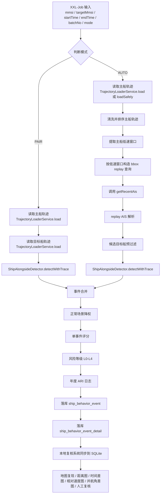

# 船舶搭靠指标 SHUJUFUWU-305 项目文档

## 1. 一句话结论

当前已完成 `ALONGSIDE_V2_INSURANCE` 的基础实现，支持指定双船 `PAIR` 复核、不传 `targetMmsi` 的 `AUTO` 单船候选召回、主船低速窗口提取、`getRecentAis` 区域回放、候选目标船预过滤、搭靠确认、事件评分、风险等级和事件明细落库。当前结果定位是“搭靠候选事件识别 + 轻量保险化评分 + 人工复核依据”，尚不是最终保险评分口径，也不是最终核保结论。

当前版本已经具备业务试运行、案件复盘、规则调试和本地复核能力，但仍缺少港口、锚地、报备 STS、制裁区、目标船画像、PSC、事故等外部证据，因此不能把所有近距离低速事件直接理解为异常搭靠。

## 2. 业务定位与保险风控价值

船舶搭靠在保险风控里有价值，是因为它可能对应真实的双船接触、并靠、转运、补给、共同等待、锚地靠泊或其他需要进一步解释的行为线索。对于理赔、核保和船队画像来说，“一条船与谁在什么时间、什么位置、以什么速度、持续多久发生过近距离低速伴随”本身就是高解释力数据。

但“近距离 + 低速”不等于“异常”。港口靠泊、锚地等待、引航、拖轮协助、报备 STS、补给、救助、避碰后并行、同一水域低速等待，都可能出现类似 AIS 形态。因此当前指标只能输出“搭靠候选事件”，不能直接输出“异常行为”。

当前指标与其他风险主题的关系如下：

- 与 `STS` 的关系：搭靠是识别 STS 候选的重要前置线索，但没有 STS 热点、作业报备、货类和对象画像时，不能把搭靠候选直接等同于 STS 风险。
- 与补给、锚地等待、港口作业的关系：这些正常场景会产生大量近距离低速事件，因此当前版本只做轻量降权，不做强排除。
- 与制裁船舶、影子船队的关系：搭靠事件如果未来能关联高风险目标船，将显著增强保险解释力，但当前 `counterpartyRiskScore=0`，尚未接入该类画像。
- 与 AIS 中断的关系：搭靠片段周围出现 AIS gap 可能提高风险关注度，但 AIS gap 本身也可能来自采样质量问题，因此当前只作为 `behaviorRiskScore` 的一部分。
- 与徘徊的关系：徘徊是单船停留/机动，搭靠是双船近距离低速伴随。两者未来应形成事件链联动，但当前仍分别计算。

当前指标适合用于以下业务场景：

- 理赔调查：复盘事故前后是否存在双船近距离低速接触。
- 核保复核：为人工核保提供“近期与哪些目标船发生过候选搭靠”的证据线索。
- 船队异常行为画像：沉淀船队年度接触行为统计。
- 船舶间接触风险识别：识别双船短时或持续接触行为。
- 高风险对象接触线索：后续与制裁船、影子船、事故船、低评级船做关联。
- 后续年度搭靠风险评分 `ARI`：作为年度行为维度子项之一。

## 3. 当前开发状态

| 模块 | 当前状态 | 说明 |
|---|---|---|
| XXL-Job 单船入口 | 已完成 | `shipAlongsideJobHandler` |
| XXL-Job 批量入口 | 已完成 | `shipAlongsideBatchJobHandler` |
| PAIR 模式 | 已完成 | 指定 `mmsi + targetMmsi` 双船复核 |
| AUTO 模式 | 已完成初版 | 不传 `targetMmsi` 自动召回候选船 |
| 低速窗口提取 | 已完成 | 用于 AUTO 召回前置收敛 |
| getRecentAis 召回 | 已完成 | `bbox` 区域回放查询 |
| replay AIS 解析 | 已完成 | 分号 AIS 字符串解析为 `TrajectoryPoint` |
| 候选预过滤 | 已完成 | 时间、距离、速度、点数、持续时间 |
| 双船确认规则 | 已完成 | 距离、时间差、低速、相对速度、航向并靠 |
| 事件合并 | 已完成 | 同一对船相邻片段合并 |
| 评分与等级 | 已完成 | `event_score + L0-L4` |
| 年度 ARI 日志 | 已完成初版 | 尚未落年度表 |
| 本地复核 | 已完成初版 | `local-loitering-review` 支持搭靠复核 |
| 外部场景数据 | 未完成 | 港口、锚地、STS、制裁区等待接入 |
| 年度评分表 | 未完成 | `ship_behavior_alongside_score_yearly` 待建设 |

## 4. 输入参数与任务入口

### 4.1 PAIR 模式参数

```json
{
  "mmsi": "413433610",
  "targetMmsi": "413193000",
  "startTime": "2026-06-28 18:00:00",
  "endTime": "2026-06-30 09:40:00",
  "batchNo": "alongside-test-20260629-01",
  "mode": "PAIR"
}
```

`PAIR` 适用于：

- 已知两船关系复核
- 理赔案件调查
- 算法规则调试
- 样本标注
- 回归测试

### 4.2 AUTO 模式参数

```json
{
  "mmsi": "413433610",
  "startTime": "2026-06-28 18:00:00",
  "endTime": "2026-06-30 09:40:00",
  "batchNo": "alongside-auto-test-20260630-01",
  "mode": "AUTO"
}
```

`AUTO` 适用于：

- 不知道目标船
- 单船自动发现搭靠候选
- 后续船队批量年度风险识别

### 4.3 批量 AUTO 参数

```json
{
  "mmsi": "414790000",
  "startTime": "2026-01-01 00:00:00",
  "endTime": "2026-12-31 23:59:59",
  "sliceMode": "DAY",
  "batchNo": "alongside-single-414790000-2026-v1",
  "resume": true,
  "parallelism": 1,
  "mode": "AUTO"
}
```

说明：

- 长周期计算推荐批量 `AUTO`
- 支持 `DAY/WEEK/MONTH/CUSTOM_DAYS` 切片
- 支持断点续跑
- 避免一次性读取过多 AIS 轨迹导致 `OOM`

## 5. 当前代码链路

### 5.1 PAIR 模式链路

```text
shipAlongsideJobHandler
-> ShipBehaviorAnalysisService.analysisAlongside
-> analysisAlongsidePair
-> TrajectoryLoaderService.load(主船)
-> TrajectoryLoaderService.load(目标船)
-> ShipAlongsideDetector.detectWithTrace
-> ShipBehaviorEventRepository.saveEvents
-> ShipBehaviorEventDetailRepository.saveDetails
```

### 5.2 AUTO 模式链路

```text
shipAlongsideJobHandler
-> analysisAlongsideAuto
-> 读取主船 AIS 轨迹
-> 清洗和排序主船轨迹
-> 提取主船低速窗口
-> 按低速窗口构造 bbox replay 查询
-> 调用 getRecentAis
-> ReplayAisPointParser 解析返回 AIS 点
-> ShipAlongsideReplayCandidateProvider 预过滤候选目标船
-> ShipAlongsideDetector.detectWithTrace
-> 事件合并
-> 评分与等级
-> 落库
```

### 5.3 批量 AUTO 链路

```text
shipAlongsideBatchJobHandler
-> analysisAlongsideBatch
-> mmsiList / mmsi / ais41.recentships
-> DAY/WEEK/MONTH/CUSTOM_DAYS 时间切片
-> 安全分段读取主船轨迹
-> analysisAlongsideOneWindow(AUTO)
-> getRecentAis 候选召回
-> ShipAlongsideDetector
-> ship_behavior_event / ship_behavior_event_detail
-> ship_behavior_alongside_batch_status
```

## 6. AUTO 候选目标船召回逻辑

### 6.1 为什么不能做全量两两匹配

当前不做全量两两匹配，原因很直接：

- 船舶数量大
- 轨迹点量大
- 全量 `pair` 计算成本高
- 容易造成误报和性能问题
- 不利于 XXL-Job 任务稳定执行

因此当前采用“主船低速窗口 + 空间 `bbox` + 候选预过滤”的收敛方式。先让主船进入可能发生搭靠的时间段，再只看对应时间和空间窗口内的目标船，最后再做双船确认。

### 6.2 主船低速窗口

AUTO 不是直接拿主船整段轨迹去找目标船，而是先提取主船低速窗口：

- 先找主船低速片段
- 只有主船进入低速窗口时才触发候选目标船搜索
- 低速窗口用于控制搜索时间范围和空间范围

当前低速窗口提取使用：

- `candidate.max-speed=4.0`
- `candidate.min-duration-minutes=20`
- `candidate.split-gap-minutes=30`

### 6.3 getRecentAis 区域回放接口

配置：

```properties
ship.behavior.alongside.replay.url=https://gm.hifleet.com/spatialais/getRecentAis
```

请求参数：

```text
starttime=yyyy-MM-dd HH:mm:ss
endtime=yyyy-MM-dd HH:mm:ss
devSize=50000
minlat=...
maxlat=...
minlon=...
maxlon=...
```

特别强调：

- 参数名必须是 `starttime`，不是 `startime`

成功响应：

```text
status=1
msg=OK
data={按 MMSI 分组的 AIS 字符串数组}
```

当前客户端能力：

- `SpatialAisReplayClient` 负责 HTTP 调用、超时、重试和成功判定
- `ReplayAisPointParser` 负责把分号 AIS 字符串解析为 `TrajectoryPoint`
- `ALONGSIDE_V2 replay_query[...]` 日志会输出 `httpStatus`、`responseStatus`、`responseMsg`、`returnedVessels`、`rawPoints`、`validPoints`、`parseErrors`、`elapsedMs`

### 6.4 候选目标船预过滤

| 条件 | 阈值 |
|---|---|
| 排除主船自身 | `targetMmsi != ownMmsi` |
| 目标船有效点数 | `>= candidate.min-points` |
| 目标船速度 | 至少一个点 `sog <= 4 kn` |
| 时间邻近 | `timeGap <= 10 分钟` |
| 空间邻近 | `distance <= 0.5 海里` |
| 候选持续时间 | `>= 20 分钟` |

配置：

```properties
ship.behavior.alongside.candidate.max-distance-nm=0.5
ship.behavior.alongside.candidate.max-speed=4.0
ship.behavior.alongside.candidate.max-time-gap-minutes=10
ship.behavior.alongside.candidate.min-points=3
ship.behavior.alongside.candidate.min-duration-minutes=20
```

补充说明：

- `prefilteredTargets` 表示通过回放预过滤的目标船数量
- `candidateTargets` 表示去重后的候选目标船数量
- `candidatePairs` 表示“窗口 + 目标船”维度的候选组合数

## 7. 搭靠确认规则

### 7.1 轨迹清洗

确认前统一执行轨迹清洗：

- 过滤空点
- 时间为空过滤
- 经纬度越界过滤
- `speed < 0` 或 `> 80 kn` 过滤
- 按时间排序
- `time + lon + lat` 去重

### 7.2 时间匹配

规则：

```text
timeGap <= confirm.max-time-gap-minutes
```

默认：

```properties
ship.behavior.alongside.confirm.max-time-gap-minutes=10
ship.behavior.alongside.confirm.high-confidence-time-gap-minutes=5
```

匹配策略：

- 优先时间最近
- 时间接近时再选择距离最近

### 7.3 距离规则

```properties
ship.behavior.alongside.confirm.max-distance-nm=0.15
```

说明：

- 持续小于 `0.15` 海里更支持搭靠候选
- 当前兼容旧配置 `ship.behavior.alongside.max-distance-nm=0.1`
- 后续接入船长 `LOA` 后可做动态距离阈值

### 7.4 速度与相对速度规则

```properties
ship.behavior.alongside.confirm.max-speed=2.0
ship.behavior.alongside.confirm.max-relative-speed=1.0
```

说明：

- 主船 `SOG <= 2 kn`
- 目标船 `SOG <= 2 kn`
- `abs(sogA - sogB) <= 1 kn`

当前相对速度是轻量版本，后续可升级为 `COG + SOG` 向量相对速度。

### 7.5 航向并靠规则

公式：

```text
headingDiff = abs(courseA - courseB)
headingDiff = min(headingDiff, 360 - headingDiff)
parallelDiff = min(headingDiff, abs(headingDiff - 180))
parallelDiff <= 30°
```

说明：

- 同向并靠可以命中
- 反向并靠可以命中
- 双方速度极低时 `COG` 可能不稳定，不硬过滤，但影响置信度

### 7.6 持续时间与点数

| 类型 | 条件 | 处理 |
|---|---|---|
| 弱候选 | `duration >= 20 分钟`，`pointCount >= 3` | `WEAK_ALONGSIDE_CANDIDATE` |
| 正式候选 | `duration >= 30 分钟`，`pointCount >= 6` | `ALONGSIDE_CONFIRMED_CANDIDATE` |

弱候选：

- `event_score <= 20`
- `severity_level=L1`
- 不进入年度正式扣分

正式候选：

- 可进入年度 `ARI` 计算

### 7.7 事件合并规则

配置：

```properties
ship.behavior.alongside.merge.enabled=true
ship.behavior.alongside.merge.max-gap-minutes=30
ship.behavior.alongside.merge.max-center-distance-nm=1.0
```

规则：

- 同一对船
- 相邻事件间隔 `<= 30 分钟`
- 事件中心点距离 `<= 1.0 海里`

补充说明：

- 当前检测器内已实现同一对船片段合并
- `AUTO` 模式下跨候选目标的复杂去重合并仍有继续优化空间

## 8. 正常场景降权

当前没有港口、锚地、报备 `STS`、拖轮、引航、救助等外部数据，因此不做强排除，只做轻量降权。

规则：

- 主船或目标船 `nav_status` 命中 `ANCHOR / MOORED / BERTH` 或状态值 `1 / 5`
- `exclusion_flag=DOWNGRADED_NORMAL_LIKELY`
- `exclusion_reason=NAV_STATUS_ANCHORED_OR_MOORED`
- `event_score * 0.5`

未命中正常场景：

- `exclusion_flag=VALID_RISK_EVENT`
- `exclusion_reason=NO_SCENE_DATA`

特别强调：

- `VALID_RISK_EVENT + NO_SCENE_DATA` 不是“已确认异常”
- 它只表示“当前没有外部场景数据可排除”

## 9. 单事件评分与风险等级

公式：

```text
event_score = baseEvidenceScore
            + sceneRiskScore
            + counterpartyRiskScore
            + behaviorRiskScore
            + durationRiskScore
            + recurrenceRiskScore
```

当前已实现：

- `baseEvidenceScore`：距离、持续时间、点数、时间差、相对速度、航向并靠
- `behaviorRiskScore`：搭靠片段内 `AIS gap`
- `durationRiskScore`：长时间搭靠增强
- `sceneRiskScore=0`：等待港口、锚地、`STS`、制裁区
- `counterpartyRiskScore=0`：等待目标船画像
- `recurrenceRiskScore=0`：等待年度重复统计

等级映射：

| 分数 | 等级 |
|---|---|
| 0 | L0 |
| 1-25 | L1 |
| 26-50 | L2 |
| 51-75 | L3 |
| 76-100 | L4 |

说明无外部场景和对象画像时默认封顶：

```properties
ship.behavior.alongside.severity-cap.no-scene-data.max-level=L2
ship.behavior.alongside.auto-l4-enabled=false
```

补充说明：

- 生产代码在“无场景数据 + 无对象画像 + 无 AIS gap + 非 HIGH 置信度”时会执行 `L2` 封顶
- 即使理论分数达到 `L4`，在当前默认配置下也不会直接输出 `L4`

## 10. 年度搭靠风险指标 ARI

当前 `AUTO` 已输出时间窗年度指标日志，但尚未落年度评分表。

字段：

- `eventCount`
- `validEventCount`
- `highRiskEventCount`
- `severeEventCount`
- `uniqueTargetCount`
- `totalDurationMinutes`
- `maxDurationMinutes`
- `aisGapRelatedCount`
- `maxEventScore`
- `ARI`
- `subScore10`
- `weightedScore`
- `manualReview`

权重：

```text
L0 = 0
L1 = 1
L2 = 2
L3 = 4
L4 = 8
```

增强：

- 伴随 AIS gap：事件权重 `* 1.2`
- 正常降权事件：不进入 `ARI`
- 弱候选：不进入 `ARI`

10 分制映射：

| ARI | 子评分 |
|---|---|
| 0 | 10 |
| 1-3 | 8 |
| 4-8 | 6 |
| 9-15 | 3 |
| >15 或存在 L4 | 0 |

默认权重：

```properties
ship.behavior.alongside.score.weight=0.20
```

## 11. Mermaid 流程图



## 12. 落库设计

### 12.1 `dataanalysis.ship_behavior_event`

核心字段包括：

- `behavior_type=ALONGSIDE`
- `mmsi`
- `target_mmsi`
- `start_time`
- `end_time`
- `duration_minutes`
- `min_distance_nm`
- `max_distance_nm`
- `avg_speed`
- `point_count`
- `rule_version=ALONGSIDE_V2_INSURANCE`
- `batch_no`
- `event_sub_type`
- `severity_level`
- `event_score`
- `confidence_level`
- `exclusion_flag`
- `exclusion_reason`
- `ais_gap_count`
- `max_ais_gap_minutes`
- `track_coverage_ratio`
- `center_lon`
- `center_lat`
- `radius_nm`
- `score_detail_json`

现有表中还包含：

- `start_lon`
- `start_lat`
- `end_lon`
- `end_lat`
- `created_at`

### 12.2 `dataanalysis.ship_behavior_event_detail`

说明：

- `point_role=OWN` 表示主船点
- `point_role=TARGET` 表示目标船点
- 明细表用于事件轨迹快照和复核
- 不作为 AIS 原始轨迹归档

核心字段包括：

- `behavior_type`
- `mmsi`
- `target_mmsi`
- `point_role`
- `event_start_time`
- `event_end_time`
- `point_time`
- `point_index`
- `lon`
- `lat`
- `speed`
- `course`
- `nav_status`
- `batch_no`
- `rule_version`

## 13. 已验证样例

PAIR 测试参数：

```json
{
  "mmsi": "413433610",
  "targetMmsi": "413193000",
  "startTime": "2026-06-28 18:00:00",
  "endTime": "2026-06-30 09:40:00",
  "batchNo": "alongside-test-20260629-01"
}
```

历史验证结果：

- `ownPoints=42`
- `targetPoints=46`
- `events=5`

本地复核样例：

- `event_key=126`
- `mmsi=413433610`
- `target_mmsi=413193000`
- `event_sub_type=WEAK_ALONGSIDE_CANDIDATE`
- `own_point_count=4`
- `target_point_count=4`
- `matched_pair_count=4`
- `avg_distance_nm=0.03460`
- `avg_time_gap_seconds=239.5`
- `avg_relative_speed=0.05`
- `confirm_point_ratio=1.0`
- `weak_candidate=1`
- `suggested_sub_type=ALONGSIDE_WEAK`

为什么“确认点比例高”和“弱候选”不矛盾：

- `confirm_point_ratio` 只说明在当前已匹配点对中，满足距离、时间差、双方低速和相对速度阈值的点占比高
- 生产规则不会只看确认点比例
- 生产还会综合持续时长、点数、评分证据、正常场景降权和弱候选分层规则
- 因此“局部证据好”不等于“已经达到正式候选标准”

## 14. 本地复核系统说明

`local-loitering-review` 的作用：

- 只读同步远程事件表和明细表
- 保存到本地 SQLite
- 本地复算搭靠指标
- 双船地图复现
- 两船距离图、时间差图、相对速度图、并航角差图
- 人工复核
- `CSV` 导出
- 不重新跑生产算法
- 不写生产库

当前本地复核系统会把生产事件和本地解释分开处理：

- 生产口径来自 `ship_behavior_event` 和 `ship_behavior_event_detail`
- 本地复算口径来自 `event_alongside_metrics` 和 `event_alongside_pair_match`
- 页面自动备注会解释平均距离、时间差、相对速度、并航比例、确认点比例和弱候选含义

结合截图 `/Users/raymondlu/LocalProject/船舶风险评估数据服务/测试结果/船舶搭靠事件溯源.png` 可以说明：

- 本地系统能够展示事件列表
- 能展示事件级搭靠复算指标
- 能在地图上同时复现 `OWN` 和 `TARGET` 轨迹
- 能输出自动解释备注和复核建议

因此，本地系统的价值不是“替代生产算法”，而是证明搭靠事件“可追溯、可解释、可复核”。

## 15. 当前边界与风险提示

必须强调：

- 当前不是最终保险评分口径
- 当前不应把所有近距离低速事件判为异常
- 当前尚未接入港口、锚地、泊位、STS 热点、制裁区、船舶画像、PSC、事故等外部数据
- 无外部证据时不输出 `L4`
- 弱候选不进入正式年度评分
- 不做全量两两匹配
- 明细表不是 AIS 原始轨迹归档
- `AUTO replay` 结果为空时，不等于算法失败，需要看 `replay_query`、`candidate_summary` 和 `detector` 规则

补充排查口径：

- `lowSpeedWindows=0` 说明主船没有进入候选低速窗口
- `replayQueries>0` 且 `returnedVessels=0` 说明接口成功但区域内无船
- `returnedVessels>0` 但 `prefilteredTargets=0` 说明回放有船，但没有通过时间/距离/速度/持续时间预过滤
- `prefilteredTargets>0` 但 `savedEvents=0` 说明回放候选存在，但未通过正式搭靠确认规则

## 16. 后续迭代建议

- `P0`：继续打磨 `V2` 事件识别，增加明细点 `distance`、`time_gap_seconds`、`relative_speed`、`heading_diff`
- `P1`：优化 `AUTO` 候选目标船搜索，支持更稳健的 replay 查询拆分、截断重查、候选去重
- `P2`：新增年度搭靠评分表 `ship_behavior_alongside_score_yearly`
- `P3`：接入港口、锚地、`STS` 热点、制裁区、目标船画像、`PSC`、事故、影子船队
- `P4`：与徘徊、`AIS` 中断、异常停泊、异常改航形成事件链联动评分


### 问题与下一步
-
````
